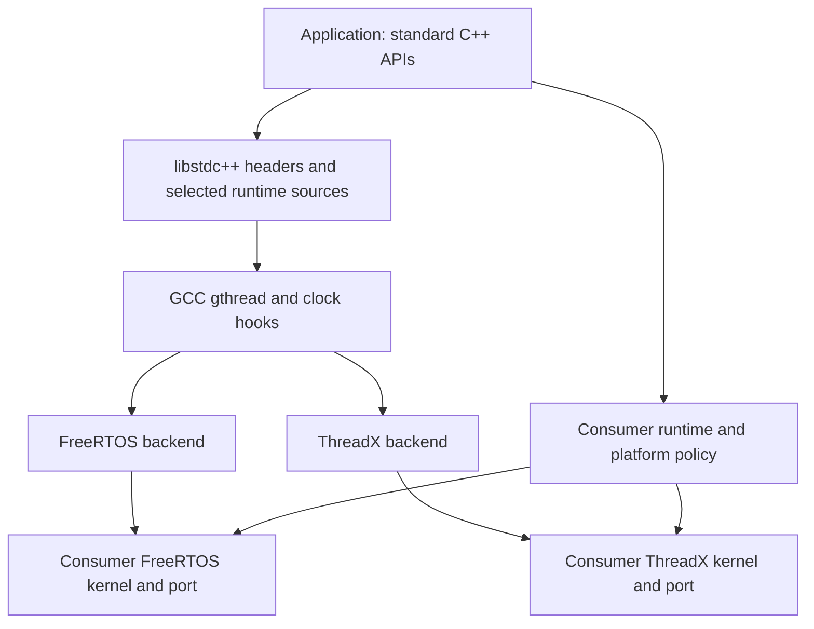

# Architecture and ownership

The diagram shows the alternatives; one backend is selected per image. The
library connects libstdc++ to the selected RTOS. It is neither a complete
standard library nor a POSIX implementation. Functions with pthread names serve
the selected GCC clock-wait header paths; they do not expose a public pthread
layer. [Shared integration](integration.md) owns the API/ABI contract; the
[FreeRTOS](backends/freertos.md) and [ThreadX](backends/threadx.md) guides own
native kernel requirements.

## Source responsibilities

| Location | Responsibility |
| --- | --- |
| `include/rtos_stdcpp` | Public attributes/thread factories, wall-clock extensions, native initialization and runtime/TLS allocation hooks |
| `src/backends/freertos` | FreeRTOS native thread/context lifetime, synchronization, one exit key and clocks |
| `src/backends/threadx` | ThreadX native thread/context lifetime, reaper, synchronization, one exit key and clocks |
| `src/toolchains/gcc` | gthread backend selection, common emulated TLS providers and ABI configuration |
| `src/runtime`, `cmake/runtime.cmake` | Optional Cortex-M newlib locks, static guards, allocation helpers and linker checks |
| `cmake/profiles` | Compiler/header/multilib identities and supported host majors |
| `third_party/libstdcxx` | Unmodified GCC mutex/CV/future providers and the modified C++20 stop-token header |
| `tests/catalog.json` | Stable case IDs, requirements and explicit skip reasons |
| `tests/conformance`, `tests/regression` | Shared standard API cases and FreeRTOS lifecycle regression |
| `tests/unit` | FreeRTOS arithmetic checked with type-only kernel stubs |
| `tests/support` | Release-safe reports/assertions, platform interface and transport hooks |
| `tests/deferred` | Unqualified future cases excluded from the supported suite |
| `platforms/qemu-vexpress-a9` | Standalone FreeRTOS test startup, runner and runtime policy |
| `platforms/riscv-virt` | Unsupported platform code |
| `third_party/freertos-kernel` | Snapshot selected by A9, never automatically by an application |

Consumers supply their own kernel and port. The library does not bundle a
ThreadX kernel.

## GCC and native ABI

The toolchain's `bits/gthr.h` includes `bits/gthr-default.h`. Include precedence
selects this library's override, which dispatches to the chosen backend's
native types and operations. Those representations appear in libstdc++ public
classes, so every affected translation unit must select the same backend and
feature settings. The profile's forced header enables GCC 14's clock-selecting
mutex/CV paths. Mixing stock, older or differently selected gthread objects is
an ABI error.

The primary OBJECT library combines the selected backend's thread, key, lifecycle
and clock units with common GCC emulated TLS and selected GCC `mutex.cc`,
`condition_variable.cc` and `future.cc`. Direct linkage preserves those providers
instead of allowing stock archive members to satisfy references. The independent
configuration interface propagates ABI requirements without injecting objects or
a circular kernel dependency. Final-image verification must check exactly one
backend/kernel/port and the intended runtime/allocator providers.

## Managed thread lifetime

Both backends allocate a stable completion block. The owner and worker each hold
one reference; moving a `std::thread` does not move the block. The worker destroys
its callable/arguments, drains language TLS destructors, invokes the registered
exit callback and releases TLS storage before publishing completion.

| Mechanism | FreeRTOS | ThreadX |
| --- | --- | --- |
| Native context | Reserved TCB TLS pointer slot 0 | `rtos_stdcpp_context` in the TCB extension |
| Default managed allocations | FreeRTOS heap | C/newlib `malloc`/`free` |
| Worker completion | Publishes an event bit and self-deletes | Returns through the kernel shell; queued for the reaper |
| Join completion | Waits for worker completion; idle later reclaims native TCB/stack | Waits until the reaper has run cleanup, deleted the native TCB and freed its stack |
| Cleanup CPU opportunity | Kernel idle task | Library reaper at `TX_MAX_PRIORITIES - 1` |

Detach drops the owner's reference without waiting. The final reference frees
the completion/event resources. Native thread identity is a canonical
`uintptr_t` word: managed IDs identify completion blocks; other IDs use tagged
TCB addresses. Copies do not own resources, and equality agrees with GCC's
raw-byte ID hash. Reused addresses can produce reused identities after their
lifetime. External deletion bypasses managed cleanup and is unsupported.

The existing gthread-key registry supports one exit key for libstdc++ exit
notification. Publication is atomic; callbacks run on managed worker return.
Language TLS uses a separate completion-block context without consuming another
key or native context slot. GCC descriptors receive stable atomic indices, a
per-worker table owns aligned values, and a LIFO list records destructors.
The common [TLS allocator option](integration.md#language-thread-local-storage)
changes TLS-owned allocations without changing native object allocation.

## Synchronization and time

| Mechanism | FreeRTOS | ThreadX |
| --- | --- | --- |
| Mutexes | Native ordinary/recursive mutex semaphores | Native mutexes; creation deferred until thread context |
| CV wakeups | Reserved task notification index 0 | A native semaphore for each wait scope |
| Waiter ownership | Intrusive list under short critical sections | Intrusive list under short critical sections |
| Broadcast serialization | Scheduler suspension | Temporary preemption threshold |
| Monotonic clock | Atomically sampled 32-bit tick/overflow pair | Extended count maintained by the explicit tick hook |

CV waits release/reacquire the caller's mutex. Timeout and notification cleanup
must agree on waiter ownership; users still wait in predicate loops and retain
mutex/CV/data until all users finish. `system_clock` adds a serialized wall offset
to monotonic time. Setting wall time leaves `steady_clock` unchanged. Deadline
conversion rounds waits up and bounds large waits; sleeps recheck monotonic time.
Resolution is the kernel tick, not an independent high-resolution hardware clock.
Interrupt masking and scheduler serialization do not permit ISR use of this API.

## C++20 waiting and cancellation

GCC's atomic waiter pool uses the selected mutex/CV hooks; semaphores, latch and
barrier build on those waits. The pool initializes on first use in thread context
and retains synchronization resources, so warm it before measuring recovery.

The embedded stop-token override changes contention backoff and optional test
hooks while preserving GCC's API/layout. Backoff calls `vTaskDelay(1)` for
FreeRTOS or `tx_thread_sleep(1)` for ThreadX, allowing lower-priority owners to
run. Ordinary `this_thread::yield()` is unchanged. All affected C++20 objects
must select the same header. Stop callbacks run synchronously on the requester
or during registration after stop and follow the usual lifetime/context rules.

## Platform boundary

The consumer owns kernel/port/configuration, startup, interrupt/FPU/cache/security
state, memory layout, allocation arenas, syscalls and fatal policy. It supplies
newlib reentrancy/locks and C++ guards directly or through the optional
[compiler runtime module](runtime.md). Recovery checks must account for all
arenas and allow the selected backend's cleanup task to run.

Optional `rtos-stdcpp::test-support` supplies shared cases/reports; a platform
supplies timing, native attributes, stack/resource observations, cleanup
opportunities, fatal handling and transport. Host reference runs use the host
runtime; the standalone emulator runs FreeRTOS. Consumer-owned board runs add
physical interrupt/FPU/cache/timing evidence for the selected backend.
See [testing](testing.md) and the [support matrix](support-matrix.md).
