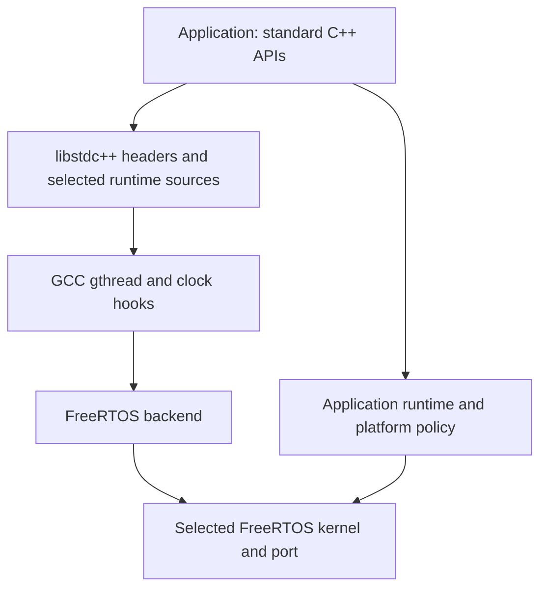

# Architecture and ownership

The library supplies the connection between libstdc++ and FreeRTOS. It is neither
a complete standard library nor a POSIX implementation. Functions with pthread
names serve the selected GCC clock-wait header paths; they do not provide a
public pthread layer. No general backend framework or ThreadX backend exists.

## Source responsibilities

| Location | Responsibility |
|---|---|
| `include/rtos_stdcpp` | Public attributes/thread factory, wall-clock extensions and TLS allocation hooks |
| `src/backends/freertos` | Thread/completion and TLS context lifetime, CV waiters, one exit key and clocks |
| `src/toolchains/gcc` | `bits/gthr-default.h` override, emulated TLS providers and common ABI configuration |
| `cmake/profiles` | Embedded compiler/header/multilib and dependency identities; supported host majors |
| `third_party/libstdcxx` | Two unmodified GCC runtime providers and the C++20 stop-token override, with source/license manifests |
| `tests/catalog.json` | Stable case IDs, requirements and explicit skip reasons |
| `tests/conformance`, `tests/regression` | Shared standard API and lifecycle/identity cases |
| `tests/unit` | Actual backend arithmetic checked with type-only kernel stubs |
| `tests/support` | Release-safe assertions/reports, platform interface, process controls and transport hooks |
| `tests/deferred` | Unqualified future sources, excluded from the supported suite |
| `platforms/qemu-vexpress-a9` | Qualified standalone test startup, runner and runtime policy |
| `platforms/riscv-virt` | Unsupported platform code |
| `third_party/freertos-kernel` | FreeRTOS 10.4.3 snapshot selected by A9, never automatically by an application |

Kernel source identities are recorded in dependency manifests. Applications
select their own kernel/port and runtime policy.

## GCC and native ABI

The toolchain's `bits/gthr.h` includes `bits/gthr-default.h`. Include precedence
selects this library's override, which maps native thread, mutex and CV operations
to FreeRTOS. The native representations appear in libstdc++ public classes;
all affected translation units must see the same headers and feature settings.
The profile's forced header enables GCC 14's clock-selecting mutex/CV paths.
Mixing stock/older gthread objects with these objects is an ABI error.

`rtos-stdcpp::rtos-stdcpp` is an object library containing backend `thread.cpp`,
`gthr_key.cpp`, `freertos_time.cpp`, the GCC emulated TLS provider and the selected
GCC `mutex.cc`, `condition_variable.cc` and `future.cc`. Direct linkage preserves the intended providers instead
of allowing stock archive members to satisfy them. The independent
`rtos-stdcpp::config` interface propagates ABI requirements without injecting
objects or a circular kernel dependency. Final-image verification must still
check provider selection and exactly one kernel/port/heap.

## Managed thread lifetime

Creation allocates a stable completion block and event group. The owner and
worker each hold one reference; moving a `std::thread` does not move the block.
The worker owns and destroys the callable/arguments, drains language TLS
destructors, runs the registered exit callback, reclaims TLS storage, publishes
completion, releases its reference and deletes itself.
Join waits for completion and releases the owner reference; detach releases the
owner without waiting. The last release frees the completion/event resources.
The kernel's idle task later reclaims the self-deleted TCB/stack.

Native thread identity is one canonical `uintptr_t` word. Managed IDs identify
the completion block; non-managed task IDs use a tagged TCB address. Copies do
not own resources. Equality and GCC's raw-byte ID hash therefore agree. IDs and
native handles are backend-specific, not permanent identifiers; allocator reuse
can reuse old identities after their lifetime. No join/detach path inspects a
reclaimed TCB. External deletion of a managed worker bypasses this contract.

The existing gthread-key registry supports one registered exit key, used by exit
notification. Its publication is atomic, and callbacks run on managed worker
return. Language TLS uses a separate per-worker context in the completion block,
without consuming another gthread key or FreeRTOS pointer slot. GCC control
descriptors receive atomic, stable indices; a growable per-worker table owns
individually aligned allocations. Destructor registration is a LIFO list drained
without locks before exit notification. There is no native-task cleanup contract.
TLS-owned allocations use the FreeRTOS heap by default; a compile-time option
selects paired application hooks for values, pointer tables and destructor
records. Completion blocks and kernel objects retain their FreeRTOS allocator.

## Synchronization and time

Mutex hooks use FreeRTOS mutex/recursive-mutex semaphores. CVs keep intrusive
waiters under a short critical section, release/reacquire the caller's mutex,
and use task notification index 0 for wakeups. Timeout/notification cleanup must
agree on waiter ownership. User code still waits in a predicate loop and keeps
mutex/CV/data alive until all users finish.

`steady_clock` extends the kernel's atomically sampled 32-bit tick/overflow pair.
`system_clock` adds a separately serialized wall offset. Setting wall time leaves
monotonic time unchanged. Duration conversion rounds deadlines up and bounds
large waits; sleep loops recheck monotonic time. Resolution is the configured RTOS
tick, not an independent high-resolution hardware clock. Interrupt masking and
scheduler suspension have distinct roles; neither permits ISR use of this API.

## C++20 waiting and cancellation

GCC's atomic waiter pool uses the existing mutex/CV hooks; semaphores, latch and
barrier build on those waits. The pool is initialized on first use in task context
and retains its synchronization resources. Warm it before measuring recovery.

The embedded `stop_token` override changes only contention backoff and optional
qualification hooks. `vTaskDelay(1)` allows lower-priority lock owners to run;
ordinary `this_thread::yield()` is unchanged. The override keeps GCC's public API
and object layout. All affected C++20 objects must select the same header.
Callbacks run synchronously on the requesting task (or during registration after
stop); callbacks must follow the ordinary task-context and lifetime rules.

## Platform boundary

The integrating application owns its kernel/port/configuration, startup,
interrupts/FPU/cache/security state, memory map, newlib reentrancy/locks, C++
guards, allocation arenas, syscalls, fatal policy and hardware qualification.
RTOS heap objects and C++/newlib allocations may use separate arenas; recovery
checks must account for both and allow idle cleanup. The A9 test platform supplies
its own implementations of these policies, with separate fixed arenas.

Optional `rtos-stdcpp::test-support` supplies shared cases/reports; a platform
supplies timing, attributes, stack/resource observations, idle opportunities,
fatal handling and transport. Host reference runs use the host runtime. Emulator
runs exercise the actual backend; board runs additionally establish physical
interrupt/FPU/cache/timing behavior. See [testing](testing.md).
